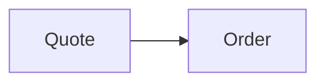
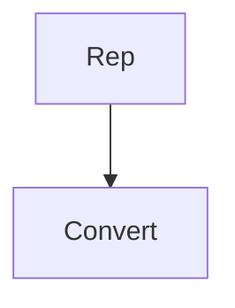
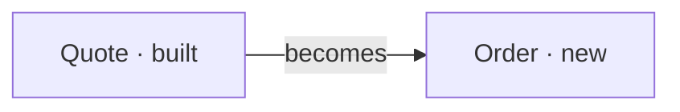

Scope    acme/shop · main
Shape    2 units in four stages
Status   proposal — no code changed
Date     2026-11-02

## 01 The plan

Quotes become orders.

Nothing else changes.

**A quote is a source and the order is the product.**

## 02 Already built

- **Quote record** — A quote holds its lines.
- **Order record** — An order holds its lines.

## 03 To be added

Two new pieces.

- **Convert action** — Turns a quote into an order.

## 04 How it fits

There is one join, at the convert action.

| Piece | Path | State | Pattern followed |
|---|---|---|---|
| Convert action | `app/models/order.rb` | New | Not relevant |

## 05 How it runs

**Converting.** A rep converts a quote from its page.

**Reading.** An order page reads its own lines.

## 06 What we gain

- **Rep** — Can convert a quote to an order. (Unit 1.1)

## 07 What we trade

- **One more page** — The order page is new. Permanent.

## 08 Settle first

**Open decisions**

1. **Where does the convert button sit?**
   - Option one: on the quote page.
   - Option two: on the quotes list.
   - Recommendation: on the quote page.
   - Why: a rep reads the quote first.
   - **Decided:** on the quote page.

**Answers that change the design**

- **Tax rules** — Asked of the accountant.

## 09 The work

### Stage 1 · End to end

#### Unit 1.1 — Convert a quote (shop)

**As a** rep,
**I want** to convert a quote,
**so that** the order needs no retyping.

## Part of
Quote-to-order conversion, stage 1 of 4 — End to end.

## How it fits

This builds on quotes.

## Acceptance criteria
- [ ] A rep can convert a quote from its page.
- [ ] The order carries the quote's lines.

## Out of scope
- Partial conversion, which is a later request.

## Dependencies
none

### Stage 2 · Enrich

#### Unit 2.1 — Email the order (shop)

**As a** rep,
**I want** the order emailed,
**so that** the client sees it.

## Part of
Quote-to-order conversion, stage 2 of 4 — Enrich.

## How it fits
Not relevant.

## Acceptance criteria
- [ ] The client gets the order by email.

## Out of scope
- Not relevant.

## Dependencies
Blocked by Unit 1.1

## 10 Risks

- **Orders may need approval.** A client could require it, which is a redesign.

---
## Generation Metadata

Scribe: plan-scribe `abc1234`
